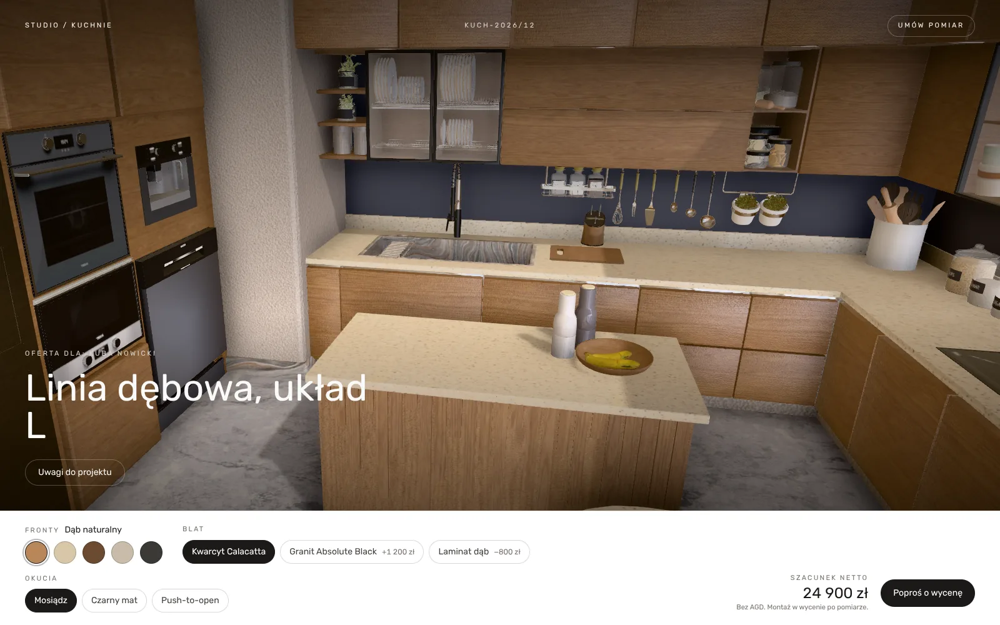
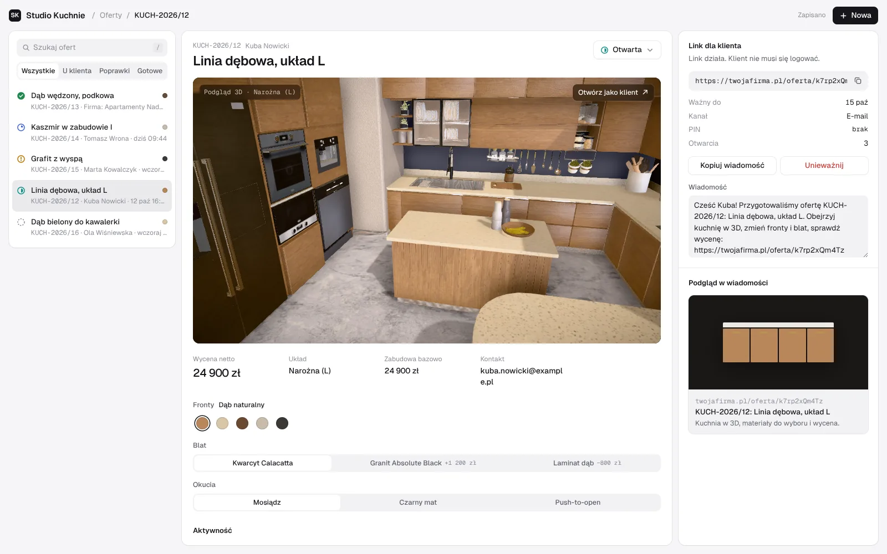

# OP RZUT – system ofertowania mebli z podglądem 3D

Aplikacja dla studiów i salonów meblowych. Projektant przygotowuje ofertę kuchni w panelu
i wysyła klientowi link. Klient ogląda kuchnię w 3D w przeglądarce, zmienia materiały,
od razu widzi cenę i zostawia uwagi.

- **Strona:** https://system-ofertowania.pages.dev
- **Przykładowa oferta (demo):** https://system-ofertowania.pages.dev/oferta/demo
- **Repozytorium:** https://github.com/pawel799/System-ofertowania-



## Funkcje

- **Panel ofert** – lista ofert ze statusami (szkic, wysłana, otwarta, poprawki, zaakceptowana),
  wyszukiwarka, edycja, unieważnianie linku i usuwanie oferty.
- **Linki dla klienta** – każda oferta ma własny, losowy adres, opcjonalny 4-cyfrowy PIN
  i datę ważności; cenę można pokazać albo ukryć osobno dla każdej oferty.
- **Konfigurator 3D** – model kuchni w WebGL z wymianą frontów, blatu i okuć;
  cena przeliczana na żywo na podstawie wspólnego katalogu materiałów.
- **Uwagi klienta** – klient zapisuje uwagi przy ofercie (razem z wybranymi materiałami),
  oferta przechodzi w panelu w status „poprawki”.
- **Rejestr otwarć** – licznik otwarć linku i historia zdarzeń oferty w panelu.
- **Dane firmy po NIP-ie** – nazwa, adres, REGON i KRS z wykazu podatników VAT (MF) i API KRS,
  z buforem w KV.
- **Szablon maila z ofertą** – HTML zgodny z popularnymi klientami poczty, podgląd pod
  [`/podglad-maila`](https://system-ofertowania.pages.dev/podglad-maila).
- **Strona produktu** – strona główna ze sceną 3D w tle, sekcjami promocyjnymi i podstronami
  (o nas, cennik, kontakt, dokumenty).



## Technologie

- **Next.js 14** (App Router, TypeScript) jako statyczny eksport
- **React Three Fiber**, **drei**, **postprocessing**, **three.js** – scena 3D (model GLB, HDRI)
- **Tailwind CSS**
- **Cloudflare Pages** + **Pages Functions** (API) + **Workers KV** (oferty, bufor danych firm,
  limity zapytań)

## Struktura

```
src/
  app/                 strony: /, /panel, /oferta/[slug], /oferta/demo, /podglad-maila, podstrony
  components/          scena 3D, pasek materiałów, katalog materiałów i cennik
  components/panel/    panel ofert, widok oferty dla klienta, uwagi
  components/site/     strona główna, nagłówek, stopka, formularze
  content/             teksty strony głównej
  lib/                 szablon maila z ofertą
functions/
  api/offers/          oferty (panel, wymaga autoryzacji)
  api/public/          widok oferty dla klienta, otwarcia, uwagi
  api/firma.ts         dane firmy po NIP-ie (panel)
  api/rejestracja/     podpowiedź nazwy firmy w rejestracji (publiczne, z limitem)
  _lib/                wspólna logika: walidacja, KV, autoryzacja
docs/                  notatki techniczne
```
